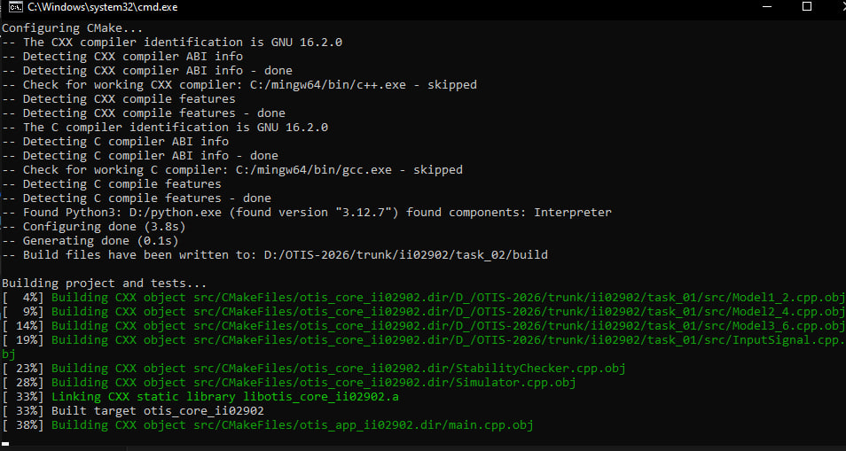
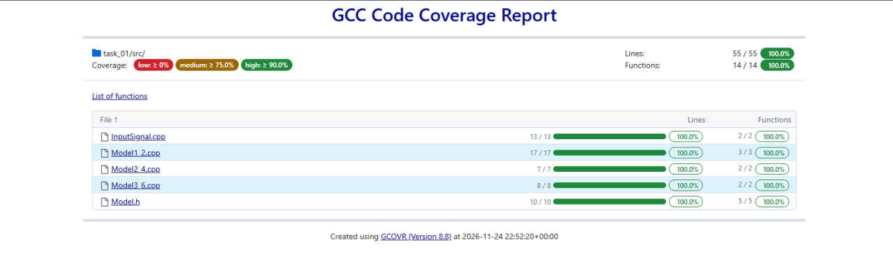
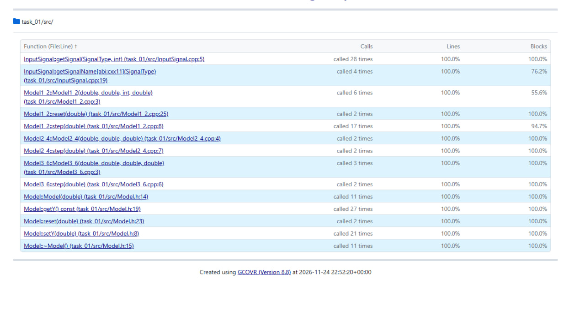

Министерство образования Республики Беларусь

Учреждение образования

«Брестский Государственный технический университет»

Кафедра ИИТ

    

Лабораторная работа №2

По дисциплине «Общая теория интеллектуальных систем»

Тема: «Модульное тестирование
»

   

Выполнил:

Студент 2 курса

Группы ИИ-29

<Барсуков Д.В.

Проверил:

Дворанинович Д. А.

   

Брест 2026

## Задание
Написать модульные тесты для программы, разработанной в лабораторной работе №1, предварительно расширив её математический и функциональный базис.

# PITCH
Вот мои старания на протяжении 4.5 часов,она является улучшением к 1 лабораторной работе.Там добавлены модульные тесты и устойчивость.Тесты представлены в html,что удобно из-за крутейшего интерфейса.Покрытие происходит на 100%,а линии на 96.4%.Исходя из данных технических возможностей программы,вы можете подключать свои файлы,проводя для них тесты,а так же просматривать время выполнения и процент прохождения каждого теста.Если вы зачтете мне эту лабу, вы найдете пару миллионов долларов США, вам больше не нужно будет рабатоть. Вам выдадут админку на сервере в маинкрафте и подарят пс5 с гта 6

## Тестовое покрытие и результаты

* **Запуск:** Скрипт (`run_tests.bat`)
* **Количество модульных тестов:** 15
* **Количество пройденных тестов:** 15 / 15

## Запуск и сборка проекта
В консоли отображается конфигурация CMake с компиляторами GNU 16.2.0 (`c++.exe` и `gcc.exe` из `C:/mingw64/bin`) и найденным Python 3.12.7[cite: 5]. Далее идёт сборка объектных файлов моделей (`Model1_2.cpp`, `Model2_4.cpp`, `Model3_6.cpp`, `InputSignal.cpp`), модулей проверки устойчивости и симулятора (`StabilityChecker.cpp`, `Simulator.cpp`), линковку статической библиотеки `libotis_core_ii02902.a` и сборка целевого приложения `otis_app_ii02902`[cite: 5].

## Отчёт о покрытии кода (HTML-дашборд `gcovr`)
На главном экране отчёта **GCC Code Coverage Report** (сформированного `GCOVR Version 8.8` для директории `task_01/src/`) зафиксировано **100.0%** покрытия по строкам (**55 / 55**) и **100.0%** по функциям (**14 / 14**)[cite: 6]. Все файлы (`InputSignal.cpp`, `Model1_2.cpp`, `Model2_4.cpp`, `Model3_6.cpp`, `Model.h`) отмечены зелёным индикатором со 100% покрытием строк и функций[cite: 6].

## Детализация по функциям (`List of functions`)
В таблице функций приведено количество вызовов (`Calls`), а также проценты покрытия по строкам (`Lines`) и блокам (`Blocks`) для методов классов `InputSignal`, `Model1_2`, `Model2_4`, `Model3_6` и базового класса `Model` (конструкторы, `step`, `reset`, `getY`, `setY`, деструктор и работа с сигналами)[cite: 7]. Все функции покрыты на `100.0%` по строкам и вызовам[cite: 7].

